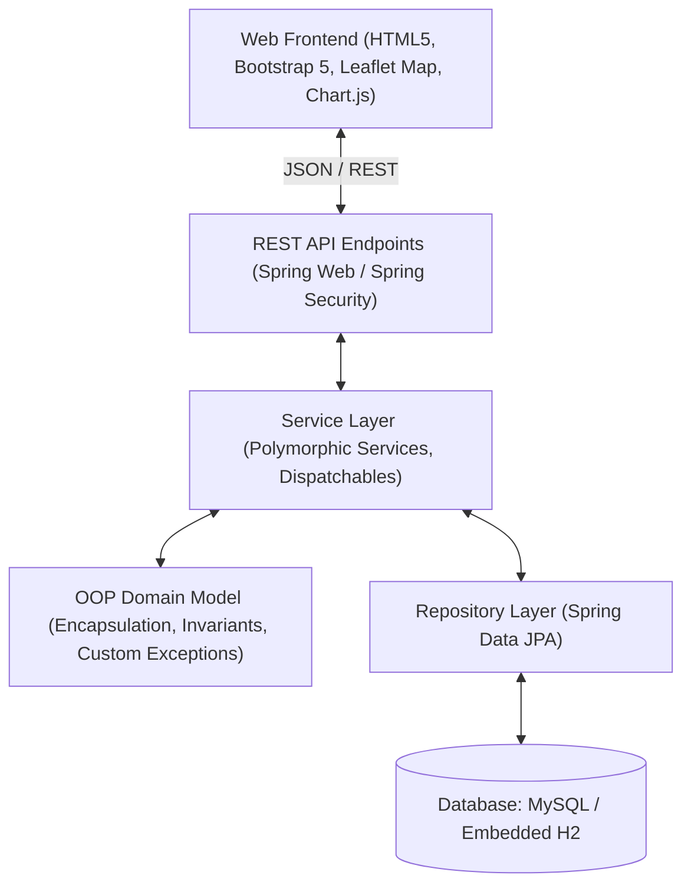

<<<<<<< HEAD
<<<<<<< HEAD
# Disaster Management System (DMS)
### Full-Stack Java OOP Academic Project

A complete, full-stack disaster management and emergency coordination web application built with **Java 17, Spring Boot, Spring Data JPA, Spring Security**, and a modern web frontend utilizing **Bootstrap 5, Chart.js, and Leaflet with OpenStreetMap**.

---

## 1. Project Overview & Architecture

The **Disaster Management System (DMS)** provides a centralized platform to coordinate emergency responses during natural disasters such as floods, earthquakes, landslides, cyclones, and fires. The application connects administrators, victims/citizens, field volunteers, and specialized rescue teams in real time.



---

## 2. Object-Oriented Programming (OOP) Implementation

This project is structured around key Object-Oriented Programming (OOP) principles:

### A. Encapsulation
- **Private Fields & Controlled Mutators:** All entity state fields are strictly `private`. State transitions occur via verified domain business methods rather than arbitrary setters.
- **Invariant Protection:**
  - `Shelter.allocate(int count)` verifies that `currentOccupancy + count <= totalCapacity` before modifying state. If exceeded, it throws `ShelterFullException`.
  - `Resource.deductStock(int amount)` guarantees non-negative stock and throws `InsufficientResourceException` if the requested quantity exceeds on-hand inventory.
  - Calculated properties such as `getRemainingCapacity()` and `getOccupancyRate()` encapsulate internal formulas.

### B. Inheritance
- **Abstract Base Class `User`:**
  - Located at `com.dms.model.User`.
  - Defines common properties (`id`, `username`, `email`, `password`, `fullName`, `phone`, `role`, `status`, `createdAt`, `updatedAt`).
  - Extends via `@Inheritance(strategy = InheritanceType.JOINED)` into specialized subclasses:
    1. `Administrator extends User`: Adds clearance levels (`adminLevel`), department, and system management capabilities.
    2. `Victim extends User`: Specializes with `currentCondition`, `emergencyContact`, `familyMembersCount`, and allocated shelter reference.
    3. `Volunteer extends User`: Specializes with `skills`, `availabilityStatus`, `assignedTasksCount`, and GPS coordinates.

### C. Polymorphism
- **Dynamic Method Overriding:**
  - `User.getRoleDescription()`: Each concrete subclass (`Administrator`, `Victim`, `Volunteer`) overrides this method to provide role-specific operational descriptions.
  - `User.canPerformAction(String action)`: Dynamically enforces permissions based on the instantiated subclass type.
- **Polymorphic Interface Execution:**
  - The `EmergencyDispatchable` interface defines `dispatch(Long responderId, Long requestId)`.
  - Implemented polymorphically by both `VolunteerServiceImpl` and `RescueTeamServiceImpl` to dispatch personnel according to their operational protocols.

### D. Abstraction & Interfaces
- **Generic CRUD Lifecycle Contract:**
  - `com.dms.common.Manageable<T, ID>`: Decouples service interfaces (`create`, `update`, `getById`, `getAll`, `delete`).
- **Reporting Abstraction:**
  - `ReportGeneratorService`: Decouples CSV export generators from underlying entity storage.
- **Audit Contract:**
  - `Auditable`: Interface implemented across all core domain entities for timestamp tracking.

### E. Exception Handling
- Custom, strongly-typed domain exception hierarchy extending `DisasterManagementException`:
  - `ShelterFullException`: Returns HTTP 409 Conflict when a shelter cannot accommodate more people.
  - `InsufficientResourceException`: Returns HTTP 400 Bad Request when supply allocation exceeds current inventory.
  - `DuplicateResourceException`: Returns HTTP 409 Conflict when an email/username is already registered.
  - `ResourceNotFoundException`: Returns HTTP 404 Not Found when IDs are missing.
- Centralized `GlobalExceptionHandler` with `@RestControllerAdvice` standardizing error envelopes (`ErrorResponse`).

---

## 3. Technology Stack

| Layer | Technologies |
|---|---|
| **Backend** | Java 17+, Spring Boot 3.2.4, Spring Web (REST), Spring Data JPA, Spring Security, BCrypt, JJWT (JSON Web Token) |
| **Frontend** | HTML5, CSS3, JavaScript (ES6+), Bootstrap 5.3, Bootstrap Icons, Chart.js 4.4, Leaflet.js 1.9.4 with OpenStreetMap |
| **Database** | MySQL (with Embedded H2 fallback for zero-friction testing) |
| **Build & Tools** | Maven 3+, Postman, VS Code / IntelliJ IDEA |

---

## 4. User Roles & Demo Credentials

> [!NOTE]
> All passwords below are provided for development and academic evaluation only.

| Role | Username | Password (Dev-only) | Full Name | Description |
|---|---|---|---|---|
| **Administrator** | `admin` | `admin123` | Dr. Robert Vance | Full clearance over disasters, shelters, resources, dispatching, and analytics. |
| **Victim / Citizen** | `victim1` | `victim123` | Alice Johnson | Can submit disaster reports, request emergency aid, and find safe shelters. |
| **Volunteer** | `volunteer1` | `volunteer123` | Sarah Connor | Can view assigned tasks, update availability, and accept field assignments. |
| **Rescue Team** | `capt_wilson` | `rescue123` | Capt. James Wilson | NDRF Quick Response Team leader for boat rescues and evacuation. |

---

## 5. Main Modules & 17 Application Views

The web frontend includes all 17 required application views:

1. **Home / Landing Page:** Key metrics, emergency guidelines, quick-report intake, and situation briefing.
2. **Registration Page:** Role-based registration with custom fields for volunteers and victims.
3. **Login Page:** Standard login with BCrypt authentication.
4. **Victim Dashboard:** Personal emergency requests, live tracking, and nearby shelter directory.
5. **Disaster Reporting Form:** Interactive form with coordinates, casualties estimation, and photo URL.
6. **Emergency Assistance Request Page:** Requests for rescue, food/water, medical aid, or temporary shelter.
7. **Volunteer Dashboard:** Tasks queue, task acceptance, and availability toggle.
8. **Rescue Team Dashboard:** High-priority rescue operations board and survivor extrication status.
9. **Shelter Directory:** Visual capacity bars, bed occupancy percentage, and victim allocation modal.
10. **Relief Resource Page:** Inventory monitoring, automated stock deduction, and restocking modal.
11. **Interactive Disaster Map:** OpenStreetMap using Leaflet, custom color-coded hazard pins, and popups.
12. **Admin Command Center:** Real-time summary cards, Chart.js visualizations, and live audit log stream.
13. **Disaster Reports Management:** Searchable table for administrators to verify, prioritize, and update incidents.
14. **User & Volunteer Management:** Approval queue for volunteers and personnel summaries.
15. **Rescue Operations Management:** Central dispatch command assigning teams and volunteers to requests.
16. **Reports & Analytics Page:** One-click CSV export for Disasters, Emergency Requests, Shelters, and Resources.
17. **User Profile & Settings:** Profile details and OOP role description viewer.

---

## 6. Project Directory Structure

```
disaster-management-system/
├── pom.xml                               # Maven Project Descriptor
├── mvnw / mvnw.cmd                       # Maven Wrapper scripts
├── .mvn/wrapper/                         # Maven Wrapper properties
├── database/
│   ├── schema.sql                        # MySQL Table DDL script
│   ├── data.sql                          # MySQL Sample Seed Data script
│   └── setup_mysql.sql                   # MySQL setup script
├── src/
│   ├── main/
│   │   ├── java/com/dms/
│   │   │   ├── DisasterManagementApplication.java  # Main Spring Boot Runner
│   │   │   ├── common/                   # Common Interfaces (Manageable, EmergencyDispatchable, Auditable)
│   │   │   ├── config/                   # SecurityConfig, JwtTokenProvider, DataInitializer
│   │   │   ├── controller/               # REST API Controllers (Auth, Disasters, Shelters, Resources, etc.)
│   │   │   ├── dto/                      # Data Transfer Objects
│   │   │   ├── exception/                # Custom Exceptions & GlobalExceptionHandler
│   │   │   ├── model/                    # OOP Entities (User, Administrator, Victim, Volunteer, Shelter, etc.)
│   │   │   │   └── enums/                # System Enums (DisasterType, Severity, Status, etc.)
│   │   │   ├── repository/               # Spring Data JPA Repositories
│   │   │   └── service/                  # Business Logic Interfaces & Implementations
│   │   └── resources/
│   │       ├── application.properties    # Default Configuration (Embedded H2 / Auto-seed)
│   │       ├── application-mysql.properties # MySQL Production Configuration
│   │       └── static/                   # Web Frontend (HTML, CSS, JavaScript)
│   │           ├── index.html            # Main Single-Page Web Interface
│   │           ├── css/styles.css        # Navy & Emergency Red Styling
│   │           └── js/                   # Modular Client Scripts (api.js, auth.js, map.js, charts.js, app.js)
│   └── test/java/com/dms/                # Unit & Integration Tests
│       ├── DisasterManagementApplicationTests.java
│       ├── service/ShelterServiceTest.java
│       ├── service/ResourceServiceTest.java
│       └── oop/OopPrinciplesTest.java    # Explicit OOP Verification Tests
└── frontend/                             # Standalone Frontend Mirror
    ├── index.html
    ├── css/styles.css
    └── js/
```

---

## 7. Setup & Execution Instructions

### Option A: Instant Run with Default Profile (Zero Configuration)
The application defaults to an embedded H2 database with automatic schema generation and realistic sample data.

1. Open a terminal inside the project directory:
   ```bash
   cd disaster-management-system
   ```
2. Build and launch with Maven:
   ```bash
   mvn clean spring-boot:run
   ```
   *(Or using wrapper: `./mvnw spring-boot:run` on Linux/Mac or `mvnw.cmd spring-boot:run` on Windows)*
3. Open your browser and navigate to:
   - **Web Application:** `http://localhost:8080`
   - **H2 Database Console:** `http://localhost:8080/h2-console`
     - JDBC URL: `jdbc:h2:mem:disaster_db`
     - User Name: `sa`
     - Password: *(leave blank)*

### Option B: Running with MySQL Database

1. Start your local MySQL service.
2. Create the database and import schema and sample data:
   ```bash
   mysql -u root -p < database/setup_mysql.sql
   ```
3. Verify or adjust the MySQL credentials in `src/main/resources/application-mysql.properties`:
   ```properties
   spring.datasource.url=jdbc:mysql://localhost:3306/disaster_management_db?createDatabaseIfNotExist=true&useSSL=false&serverTimezone=UTC
   spring.datasource.username=root
   spring.datasource.password=root
   ```
4. Run the Spring Boot application with the `mysql` profile:
   ```bash
   mvn spring-boot:run -Dspring-boot.run.profiles=mysql
   ```

### Option C: Standalone Frontend Evaluation (No Java/Maven Required)
If you wish to test the user interface immediately without launching the backend:
1. Simply double-click `frontend/index.html` or open it in any web browser (`Google Chrome`, `Firefox`, `Edge`).
2. The frontend automatically detects that the backend is offline and connects to the in-browser `localStorage` data store.
3. All interactive features (Role Switching, Disaster Reporting, Emergency Requests, Shelter Allocations, Resource Deductions, Leaflet Map, Chart.js, and CSV Downloads) work directly in the browser!

---

## 8. REST API Reference

| Method | Endpoint | Description | Permitted Roles |
|---|---|---|---|
| `POST` | `/api/auth/login` | Authenticate user & retrieve JWT token | Public |
| `POST` | `/api/auth/register` | Register new user (Admin, Victim, Volunteer) | Public |
| `GET` | `/api/disasters` | Retrieve all disaster reports | Public |
| `POST` | `/api/disasters` | Submit new disaster report | VICTIM, ADMIN |
| `POST` | `/api/disasters/{id}/verify` | Verify report | ADMIN |
| `PATCH` | `/api/disasters/{id}/status` | Update incident status | ADMIN |
| `GET` | `/api/requests` | List all emergency assistance requests | ADMIN, RESCUE_TEAM |
| `POST` | `/api/requests` | Submit emergency assistance request | VICTIM, ALL |
| `POST` | `/api/requests/{id}/assign-team` | Dispatch rescue team to request | ADMIN |
| `POST` | `/api/requests/{id}/assign-volunteer`| Assign volunteer to request | ADMIN |
| `GET` | `/api/shelters` | Retrieve all emergency shelters | Public |
| `POST` | `/api/shelters` | Register new shelter | ADMIN |
| `POST` | `/api/shelters/allocate` | Allocate victims to shelter (checks capacity) | ADMIN |
| `GET` | `/api/resources` | List all relief inventory supplies | Public / ALL |
| `POST` | `/api/resources/allocate` | Distribute stock to request or shelter | ADMIN |
| `POST` | `/api/resources/{id}/restock` | Restock inventory items | ADMIN |
| `GET` | `/api/dashboard/stats` | Consolidated dashboard analytics | Public / ALL |
| `GET` | `/api/reports/export/{type}` | Download CSV export (`disasters`, `requests`, `shelters`, `resources`) | ADMIN |

---

## 9. Running Automated Tests

Run the test suite with Maven:
```bash
mvn test
```

The test suite validates:
- `ShelterServiceTest`: Sync capacity allocation and `ShelterFullException`.
- `ResourceServiceTest`: Inventory deduction, status transition (`IN_STOCK` -> `LOW_STOCK` -> `OUT_OF_STOCK`), and `InsufficientResourceException`.
- `OopPrinciplesTest`: Verifies OOP inheritance hierarchy, polymorphic method execution, interface contracts, and encapsulation invariants.
=======
# disaster-management
>>>>>>> 27d3a71b60c9587b90c177b78a437ad720eefcdf
=======
# disaster
>>>>>>> f3152a61c36b699a0400cdcd915eea730a25ea66
